<div align="center">

# Fleeting

**Catch a thought before it disappears. Decide what deserves to stay.**

An iOS app for quick capture, ideas, habits, shared lists, and a daily plan.


[](https://github.com/Himir-Desai/Fleeting/actions/workflows/ci.yml)

[Features](#features) · [App flow](#app-flow) · [Architecture](#architecture-and-flow-of-control) · [Build](#build-and-run) · [Documentation](#documentation)

</div>

## Why Fleeting exists

A thought arrives mid-conversation or just before sleep. Opening an app, choosing a folder, and
filling in fields can be enough to lose it. Keeping every fragment forever creates another
problem: the useful ideas disappear into a backlog nobody wants to open.

Fleeting starts with a writing field. Save the fragment first; let the app sort it afterward.
Revisit what matters through a small review, develop an idea with a few questions, or let an
untended private thought retire to the archive. Nothing is deleted by decay.

## Product principles

| Principle | How it shapes the app |
|---|---|
| Capture comes first | No account flow, required filing, model response, or notification prompt before writing. Save locally before sorting. |
| Archive preserves the thought | Expiry retires eligible private thoughts; unfinished tasks receive explicit review. Only an explicit Delete destroys a record. |
| Sorting happens after capture | Classification and list defaults reduce filing work; manual type, list, cadence, and lifetime choices remain available. |
| Develop the person's own idea | Sharpen uses their answers and stores generated content separately from the original note. Intelligence always has a local fallback. |
| Stay quiet | Habits and reviews surface when useful. Notification permission is asked in Settings, with a daily delivery budget. |

## Version 2.1

The v2.1 work is complete. The latest uploaded version is **2.1 (6)**, eligible for external
TestFlight testing; **2.1 (5)** was uploaded as Internal Only. Upload, signing, and live-service
verification are recorded separately in [INSTALL.md](docs/INSTALL.md) and
[BUGS_V2.1.md](docs/BUGS_V2.1.md), including the last verified tester-distribution status.

- Tasks use empty/checked circles and strikethrough consistently. Completed tasks stay in
  Thoughts and Lists for **24 hours**, then appear under Archived; Plan keeps their history.
- **Mark done → Mark not done** stays in the completion slot. **Archive → Unarchive** stays in
  the archive slot. Restricted editors keep the other controls disabled, and actions share one
  horizontal row, scrolling at large accessibility sizes when needed.
- Switching main pages clears the previous thought editor and resets the thought filter to
  All. Opening a thought or Settings preserves that page's filter.
- The Lists tab always opens its selector. Repeated taps keep it open; choosing an option or
  switching pages closes it. Custom lists have a share icon directly in their top-right pill.
- Review remains **global across lists**, with a source-list label on every card, so forgotten
  lists can resurface without being opened individually.
- Home's selected-list label adapts to its text up to a maximum width. The toolbar surface and
  keyboard-dismiss state were stabilized. Thought text no longer changes weight as expiry approaches.
- CloudKit's missing sharing record type was deployed to Production, and real Production
  share-link generation was verified. Full native invitation acceptance and collaboration with
  a second account remain documented device checks.

## The app in light and dark

Current v2.1 simulator captures with disposable demo data. These are app screenshots, not mockups.
The [asset guide](docs/ASSETS.md#screenshots) records their capture commands and provenance.

| Home | Thoughts | Lists | Plan |
|---|---|---|---|
| 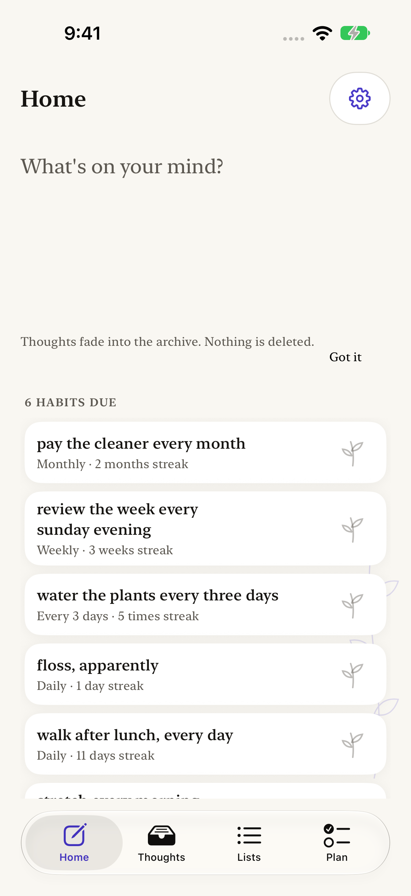 | 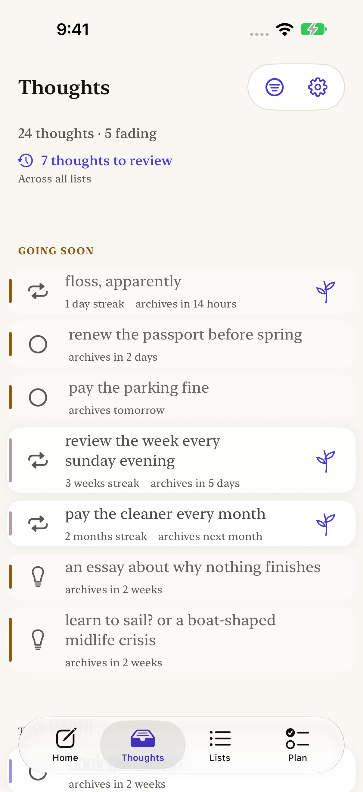 | 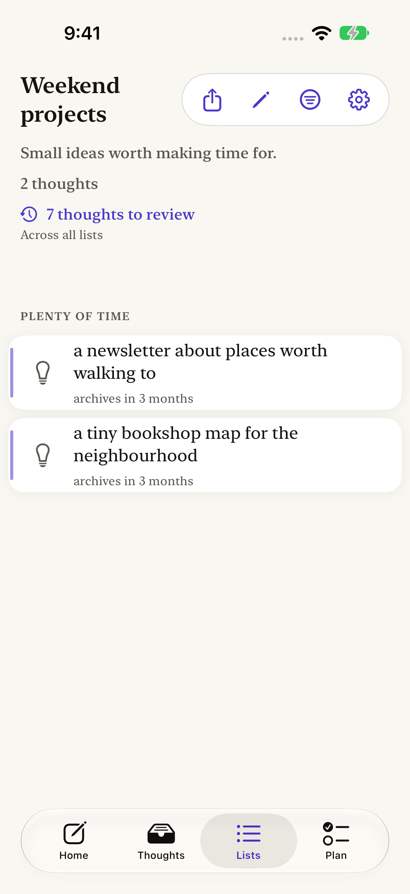 | 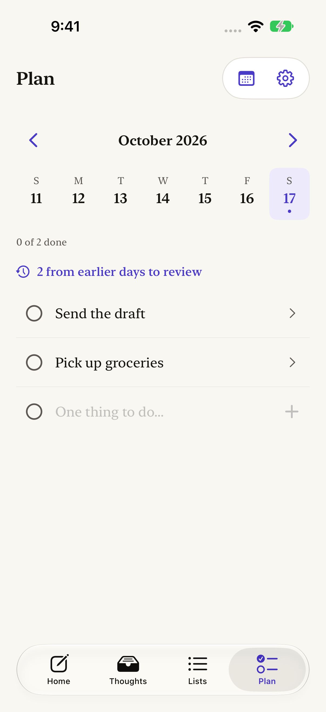 |
| 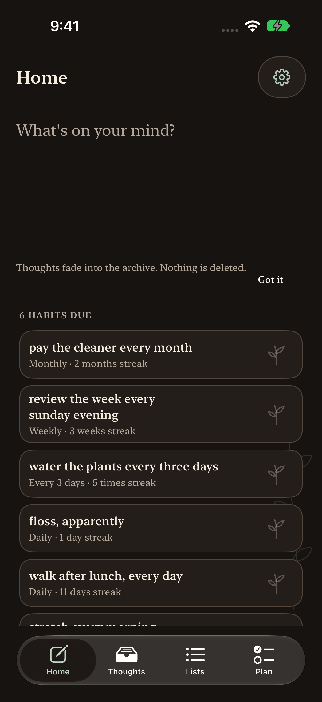 | 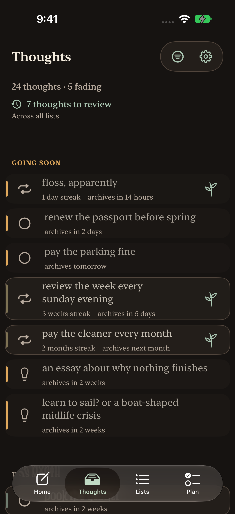 | 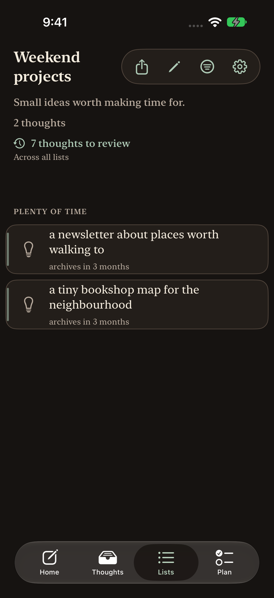 | 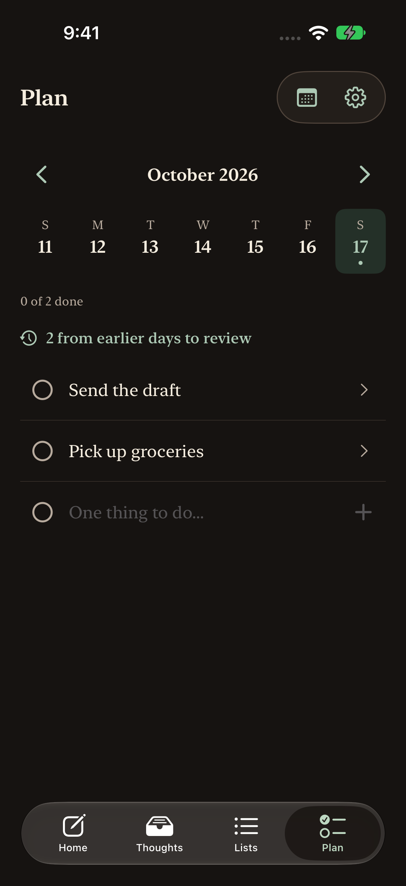 |

Browse the full [light-mode tour](docs/screenshots/v2.1/light),
[dark-mode tour](docs/screenshots/v2.1/dark), and
[largest-text task actions](docs/screenshots/v2.1/large-text-task-actions.png) for editors, list
management, Settings, and accessibility examples.

## Features

### Home: capture first, organize afterward

Plain launch opens **Home**, with a blank writing field and due habits underneath. Typing hides
the habit cards so the draft has room. A successful save clears the field and briefly shows a
receipt; a failed save keeps the text available to retry. Classification runs after storage,
without delaying the next capture.

Choose a list, a thought type, or a custom lifetime when useful. Lists can define a default type;
choosing Plan creates a task. Automatically classified tasks without a custom list go to Plan,
while a task captured into a custom list stays there. Creating a list preserves Home's draft.

Habits use a configurable cadence, including rhythms such as every three days or every month.
Marking a due habit keeps its streak and removes it from Home until it is due again. A cadence
in the captured sentence can be inferred; the app does not invent one when the note is silent.
Widget and Control Center capture links request keyboard focus directly; Siri can save through
an App Intent without opening the app.

### Thoughts and Lists: one collection, different views

**Thoughts** spans the collection. Search, type filters, and the Archived filter narrow the view;
urgency groups bring fading thoughts forward. **Lists** opens a native selector over its own
page, then displays the chosen collection. Add List and Edit Lists are in that selector.

Custom lists have a name, description, and default thought type. Their page provides Filter,
Edit, Share, and Settings controls. Plan is built in and cannot be renamed or deleted. Deleting
a private custom list keeps its thoughts. A thought's editor can change its list assignment,
including removing it with No list; shared membership has additional permission constraints.

Switching among **Home → Thoughts → Lists → Plan** returns to the destination's main page,
clears the previous thought editor without a visible slide-out, and resets thought filters to
All. Filters survive a visit to an individual thought or Settings. Settings is reachable from
the main pages and detail flows.

### Task completion and archiving

An unfinished task has an empty circle; a completed one has a checked circle and strikethrough.
Completion is shared by the task's Plan and thought representations rather than copied into a
second record. Completed tasks are excluded from thought reviews and nudges immediately.

| State | Thoughts / Lists | Detail actions | Plan |
|---|---|---|---|
| Active task | Visible | Save edits, Mark done, and normal permitted actions | Shown on its assigned day when in Plan |
| Completed less than 24 hours ago | Visible, checked and struck through | Mark not done; other editing actions disabled | Completion retained on its day |
| Completed 24 hours ago or longer | Under Archived | Mark not done; completion meaning retained | Completion history retained |
| Manually archived thought | Under Archived | Unarchive in the existing archive slot; other controls disabled | Explicitly archived tasks leave the checklist |

The same editor opens from active, completed, and archived rows. Task completion is a secondary
round action beside the other actions, separate from the explicit Save control. Large captions
wrap, and the single action row can scroll horizontally rather than shrink its tap targets.

| Completed task actions | Archived thought | Global review context |
|---|---|---|
| 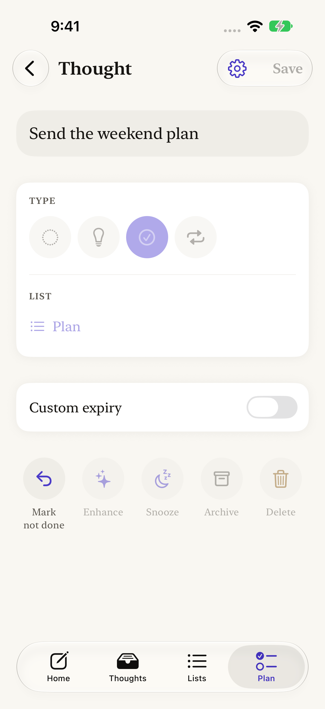 | 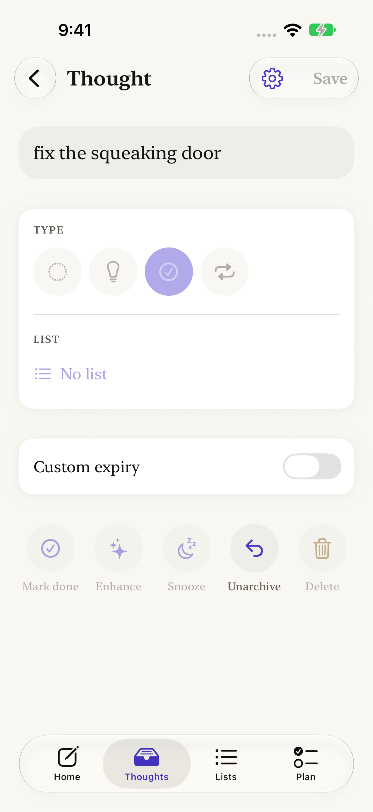 | 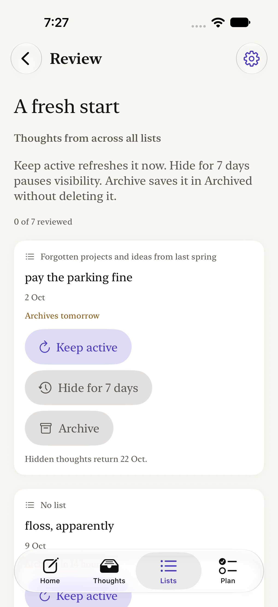 |

### Plan: the day, the week, and unfinished work

Plan presents the built-in list as a seven-day checklist. Pick a day, type a task, and press
Return to add it while keeping the next input ready. Week controls cross week boundaries; Today
returns to the current day. Tap a task's circle to complete or reopen it, and open its editor
for its properties and permitted actions.

The daily review invitation surfaces unfinished tasks from earlier days. **Finished** completes
the task on its original day; **Not finished** moves that same task to today. Nothing is carried
forward until the person decides. Unfinished tasks are protected from automatic decay archiving.
Custom-list tasks stay in their own collection rather than being pulled into personal Plan.

Today's Plan and Tomorrow's Plan widgets use the same App Group store. Supported widget
checkboxes complete the same tasks, and review links open the daily review flow. iOS controls
widget refresh timing.

### Thought review: resurface forgotten lists

A thought-review session chooses at most **seven eligible thoughts across all lists**. Opening
Review from a selected list does not restrict its scope. Each card names its source list, with
**No list** for unfiled thoughts and **List unavailable** when membership metadata cannot load.
Renaming a list updates context without restarting the session or losing decisions.

**Keep active** refreshes a thought; **Hide for 7 days** pauses it; **Archive** preserves it outside
the active view. Swipe right to keep, left to archive, or use the explicit decision buttons.
Vertical gestures scroll the cards. Archived, completed, and currently hidden thoughts do not
enter the session. Idea cards can offer an ambient sharpening question.

Daily task review and thought review share a card vocabulary but make different decisions:
one resolves unfinished days, while the other resurfaces eligible thoughts that need attention.

### Sharpen: develop the idea in your own words

Sharpen asks two or three short questions about a fragment, then turns the answers into a title
and paragraph. The captured note stays separate from the generated write-up. Revert removes
the interview and write-up without losing that original note.

Foundation Models runs on-device when available. Rules and deterministic fallbacks keep the
app usable when the model is unavailable, a request is too large, or generation fails. Settings
also offers Rules only. Context budgeting and capability checks cover the supported iOS versions.
There is no external model provider or Private Cloud Compute integration.

An optional system share action prepares a prompt containing the original note, answers, and
write-up for another assistant. This is a deliberate export through the share sheet.

| Sharpened idea | Thought review | Daily task review |
|---|---|---|
| 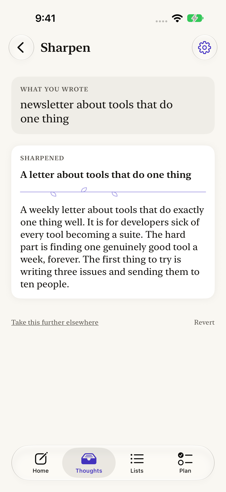 | 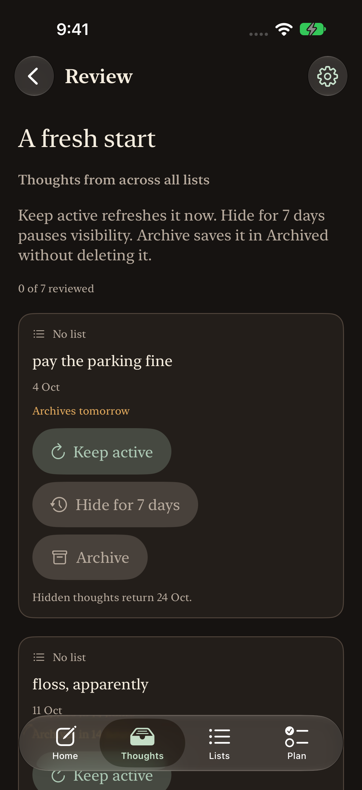 | 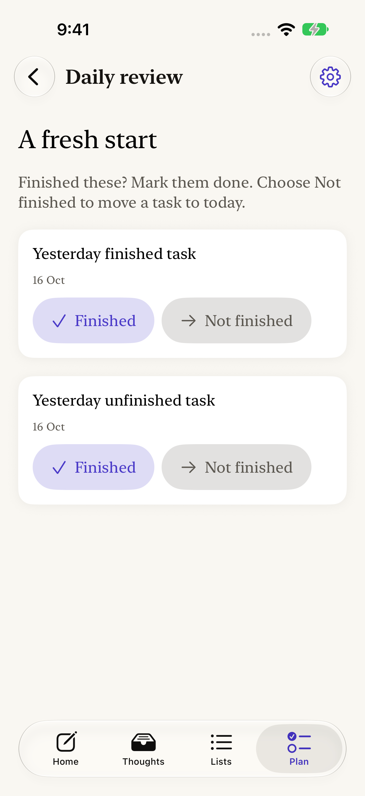 |

### Decay: retire thoughts without deleting them

Freshness changes card surface, opacity, urgency, and spoken expiry information. **Font weight
stays constant** in v2.1. Deliberate attention can refresh a thought; simply opening it does not.
Defaults are 90 days for ideas, 30 for unsorted thoughts, 14 for task freshness, and 7 for habits,
with grace periods and cadence-aware habit lifetimes. Settings and per-thought overrides can
change the applicable lifetime.

Expired private non-task thoughts move to Archived. Unfinished tasks require explicit daily
review instead of automatic archiving. Completed tasks follow the separate 24-hour visibility
rule. Shared thoughts are archived manually rather than by one participant's decay clock.
Archive is recoverable; only an explicit Delete destroys a thought.

### Shared lists and sync

A custom list's Share button opens Apple's iCloud invitation and permission UI. Owners can
manage participants, view/edit access, and sharing; participants can leave. Sharing starts with
invited people, with an optional anyone-with-the-link setting controlled through Apple's UI.
Participants need Fleeting and iCloud. Personal Plan remains private.

List content, task completion, and manual archiving are common to collaborators. Habit progress,
personal attention, hiding, and reminder preferences remain private to each account. View-only
lists disable content edits while allowing supported personal progress. Existing shared thoughts
stay in their shared list; moving them across share boundaries is not supported.

The app uses local Core Data storage with private and shared CloudKit stores. Cached content
remains available offline; iCloud imports refresh open screens. Saved sorting, lifetime, and
reminder preferences synchronize through iCloud key-value storage. Notification authorization
and delivery history are device-specific. Migration preserves store identity and retains a
recovery snapshot; the free-account local store has an import path into App Group storage.

Production sharing schema and real share-link generation have been verified. Distribution
checks verify Production CloudKit, push, App Group, and widget entitlements on the exact upload
packages. These checks do not establish invitation acceptance or collaborative editing on two
accounts; those checks remain in [ICLOUD.md](docs/ICLOUD.md#cross-account-shared-list-acceptance).

### Quiet reminders, privacy, and accessibility

Notifications are configured from Settings, with a daily nudge budget, a weekly review
invitation when needed, and expiry heads-ups. Copy is prepared ahead of delivery. Permission is
requested from Settings, never in front of capture.

There is no Fleeting account, hosted backend, analytics SDK, or tracking. On-device intelligence
keeps model requests local; iCloud sharing exposes only the list the owner chooses to share.
See the [privacy policy and manifest notes](docs/PRIVACY.md).

Both appearances support Dynamic Type, VoiceOver, increased contrast, reduced motion, and
accessible controls. Contrast tests check the palette, and focused UI checks cover large-text
editing, review, and action layouts. Floating input controls share keyboard-dismiss behavior;
the main toolbar pill uses a stable themed surface. Intermittent phone rendering symptoms are
tracked with their verification limits in the [v2.1 bug record](docs/BUGS_V2.1.md).

## App flow

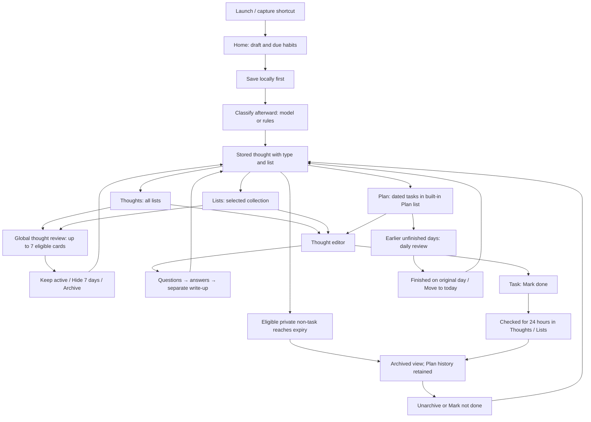

Opening Settings or a thought keeps the current filter. Switching one of the four main tabs
clears old detail routes and resets the thought filter. List selection changes the browsing
scope; it never narrows a global thought-review session.

## Architecture and flow of control

SwiftUI views bind to feature models. Models call protocols declared in Core; the app's
composition root supplies the concrete repositories, clock, intelligence, sharing coordinator,
and notification services. Features do not import other features or Persistence.

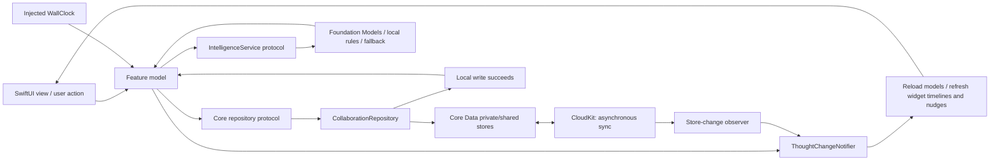

The notifier is shared by Thoughts, Lists, Plan, and review models. The Plan adapter projects
thought records into dated tasks, preserving IDs, list membership, due dates, and completion
history. A completed task's archive placement is derived from its timestamp; it does not erase
its stored completion state. Raw captured text and generated sharpening content remain separate.

| Module | Responsibility | Package dependencies |
|---|---|---|
| `App` | Composition, native tabs, routes, lifecycle, share invitation handling | All six packages |
| `Widgets` | Freshness, capture, Today/Tomorrow Plan, controls and intents | Core, DesignSystem, Persistence |
| `Core` | Thoughts, lists, lifecycle, decay/review rules, task decisions, protocols, clock | None |
| `Features` | Capture, Inbox/Lists, Plan, Review, Sharpen, Settings models and views | Core, DesignSystem |
| `Persistence` | Core Data sharing, repositories, versioned SwiftData compatibility, migration, preferences | Core |
| `Intelligence` | Foundation Models, heuristic/stub implementations, fallback and context budgeting | Core |
| `Notifications` | Nudge selection/copy, scheduling, authorization, delivery history | Core, Intelligence |
| `DesignSystem` | Palette, type, surfaces, shared controls, keyboard observation, motion and accessibility | None |

[ARCHITECTURE.md](ARCHITECTURE.md) maps the files.
[DECISIONS.md](docs/DECISIONS.md) records alternatives and tradeoffs, including v2.1's
[lifecycle/navigation changes](docs/DECISIONS.md#adr-0070--v21-lifecycle-presentation-and-navigation-corrections),
[global review context](docs/DECISIONS.md#adr-0071--thought-review-resurfaces-eligible-thoughts-across-all-lists),
and [completion/archive action slots](docs/DECISIONS.md#adr-0072--completion-and-archive-keep-their-own-action-slots).

## Validation and release status

The v2.1 implementation pass ran **372 package tests** across Core, DesignSystem, Features,
Persistence, isolated schema migrations, Intelligence, and Notifications, plus **nine distinct
focused UI cases**. Later authorized refinements passed all **18 ReviewModel tests**, both review
context/large-text UI checks, and three focused task/archive/action-row checks. These are recorded
runs at their respective revisions, not a claim that all suites were rerun on every commit.
Debug and optimized Release simulator app/widget builds passed. Normally signed device archives
and both exact uploaded IPA packages passed the distribution-capability verifier.

Time-dependent behavior uses an injected `WallClock`. Persistence and schema-migration tests run
in separate processes. The simulator screenshot tours use disposable fixtures; they do not reset
or seed the owner's signed-in simulator. CI runs package tests, formatting/lint, and app checks.
Do not run the entire UI suite locally; select only the needed case or suite.

The user accepted v2.1 as complete on **2026-10-17**. Live two-account sharing and device/widget
acceptance have their own [checklist](docs/ICLOUD.md); upload success is recorded separately from
tester availability in the [release log](docs/INSTALL.md). The [bug record](docs/BUGS_V2.1.md)
preserves the original reports, decisions, evidence, and accepted behavior.

## Build and run

**Requirements:** Xcode 27+ with the iOS 27 SDK; deployment target iOS 26.0+. Apple Intelligence
hardware and model availability affect on-device generation; local rules remain available.
The repository has six local Swift packages and no third-party runtime SDKs.

```bash
git clone https://github.com/Himir-Desai/Fleeting.git
cd Fleeting
open Fleeting.xcodeproj
```

The generated project and shared scheme are committed. If changing `project.yml`, regenerate
with [XcodeGen](https://github.com/yonaskolb/XcodeGen) and commit the project, plists, and
entitlements together:

```bash
xcodegen generate
```

Choose the Fleeting scheme and an iPhone simulator in Xcode. On a dedicated disposable simulator,
DEBUG launch arguments `--reset-store --seed-demo --seed-plan` populate screenshots and walkthroughs.
**Never use `--reset-store` on a simulator or device whose data you want to keep.**

For a phone with a free personal team:

```bash
Tools/install-device.sh
```

Trust the development signature on the phone when prompted by iOS. Free signatures expire after
seven days. Personal-team builds are device-local and cannot provide CloudKit or shared App Group
widget data. Paid-team builds require the capabilities and Production setup in
[INSTALL.md](docs/INSTALL.md) and [ICLOUD.md](docs/ICLOUD.md).

### Focused checks

```bash
swift test --package-path Packages/Core
swift test --package-path Packages/Features
swift test --package-path Packages/DesignSystem
swift test --package-path Packages/Intelligence
swift test --package-path Packages/Notifications
swift test --package-path Packages/Persistence --filter PersistenceTests
swift test --package-path Packages/Persistence --filter SchemaMigrationTests
swiftformat --lint .
git diff --check
```

For a signed distribution IPA, run `python3 Tools/verify-distribution.py /path/to/Fleeting.ipa`
before uploading. Keep normal archive signing enabled; the verifier checks the app and widget's
production capabilities as well as signatures. Screenshot-only UI commands are in the asset guide.

## Roadmap

| Release / phase | Delivered | Status |
|---|---|---|
| Foundations → Capture | Local packages, persistence, immediate capture | Complete |
| Decay → Classification | Freshness, archive, search, thought kinds and local intelligence | Complete |
| Sharpen → Review | Interview/write-up, global thought review and ambient questions | Complete |
| Ambient → Sync | Nudges, widgets, Siri, CloudKit, versioned migration | Implemented; live device checks documented |
| Daily Plan | Week checklist, completion history, explicit daily review, widgets | Implemented; device widget checks documented |
| 2.0 | Custom lists, list defaults/metadata, native navigation, iCloud collaboration | Implemented; two-account collaboration checks documented |
| **2.1** | Task lifecycle/actions, archive restore, page/filter behavior, list sharing access, global review context, stable type | **Complete; accepted 2026-10-17** |

Detailed scope, validation history, and deferred acceptance checks are in
[ROADMAP.md](docs/ROADMAP.md). New work starts from the accepted v2.1 baseline.

## Documentation

| Document | Contents |
|---|---|
| [ARCHITECTURE.md](ARCHITECTURE.md) | File map, module boundaries, where changes belong |
| [BUGS_V2.1.md](docs/BUGS_V2.1.md) | Original reports, authorized fixes, evidence, accepted behavior |
| [INSTALL.md](docs/INSTALL.md) | Simulator/device builds, signing and TestFlight release records |
| [ICLOUD.md](docs/ICLOUD.md) | Production setup, sync, permissions and two-account acceptance |
| [PRIVACY.md](docs/PRIVACY.md) | Storage, sharing boundaries, privacy manifest and collection policy |
| [ASSETS.md](docs/ASSETS.md) | Icon generation, current screenshots and reproduction commands |
| [DECISIONS.md](docs/DECISIONS.md) | Architecture/design decisions and their alternatives |
| [ROADMAP.md](docs/ROADMAP.md) | Phase scopes, completion and remaining device checks |
| [DESIGN_AUDIT.md](docs/DESIGN_AUDIT.md) | Earlier visual audit and historical comparisons |
| [LEARNING.md](docs/LEARNING.md) | Original learning track, paused after Phase 1 |

---

<div align="center"><sub>Built by Himir Desai</sub></div>
